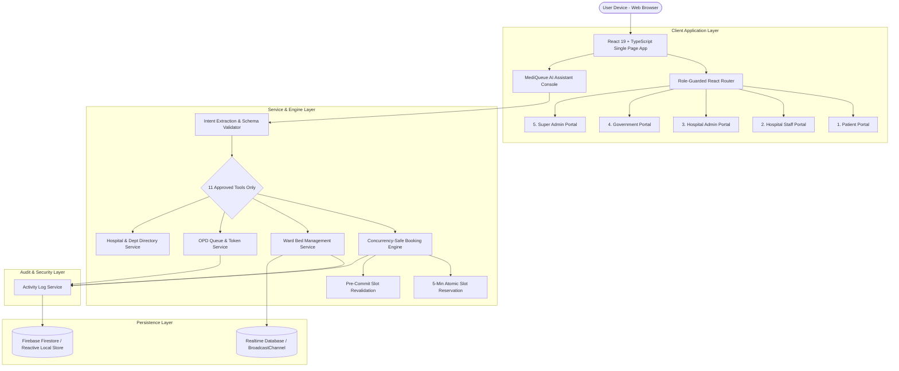
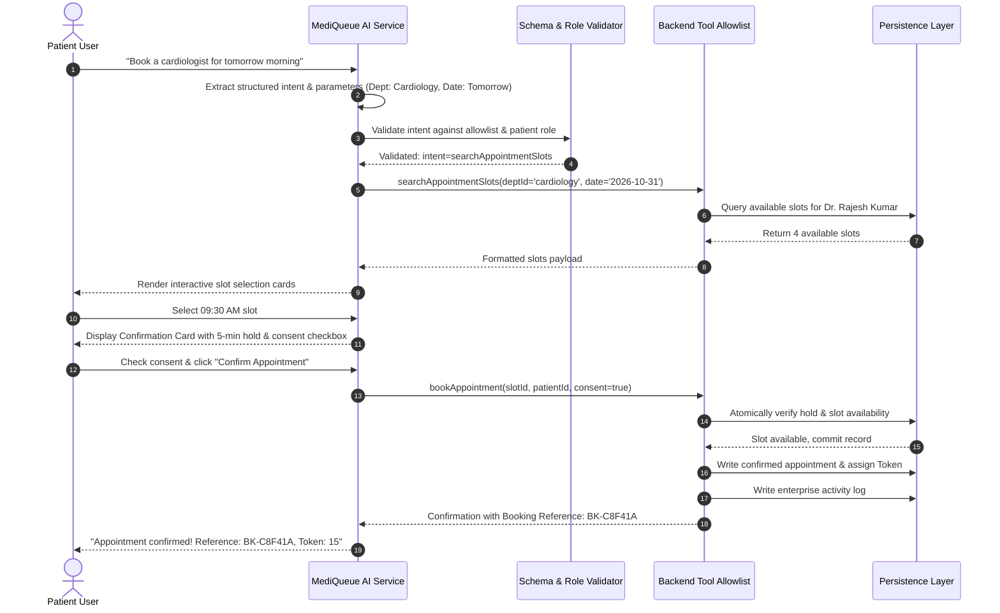

# 🎓 MediQueue AI — University Professor Presentation Guide

**Project**: MediQueue AI — An AI-Powered Real-Time Hospital Resource Management Platform  
**Audience**: University Computer Science / Engineering Evaluation Committee & Faculty  
**Presenter**: Mahith Karempudi  
**Technology Stack**: React 19, TypeScript 5, Vite 8, Tailwind CSS, Firebase / Realtime Database, Recharts, Vitest

---

## 📑 Table of Contents

1. [Executive Summary & Problem Statement](#1-executive-summary--problem-statement)
2. [High-Level System Architecture](#2-high-level-system-architecture)
3. [The 5 Operational Role Modules](#3-the-5-operational-role-modules)
4. [Hybrid AI Assistant & Intent Execution Pipeline](#4-hybrid-ai-assistant--intent-execution-pipeline)
5. [Concurrency-Safe Appointment Booking Engine](#5-concurrency-safe-appointment-booking-engine)
6. [Security Model & RBAC Enforcement](#6-security-model--rbac-enforcement)
7. [Testing & Quality Assurance](#7-testing--quality-assurance)
8. [Professor Q&A: Key Technical Defenses](#8-professor-qa-key-technical-defenses)
9. [Academic Scope & Ethical Boundaries](#9-academic-scope--ethical-boundaries)

---

## 1. Executive Summary & Problem Statement

### Modern Healthcare Operational Crises
Modern healthcare systems face four interlocking operational bottlenecks:
1. **Uncoordinated Outpatient Department (OPD) Queues**: Patients experience 2–4 hours of physical waiting room delays with zero visibility into consultation velocity.
2. **Delayed Inpatient Bed Turnaround**: Ward staff lack real-time visibility into bed cleaning, preparation, and maintenance cycles, keeping available beds blocked for hours after discharge.
3. **Fragmented Appointment Systems**: Patients cannot search real-time doctor availability across departments and hospitals or self-schedule reliably without duplicate bookings.
4. **Inter-Hospital Emergency Turnaways**: Ambulances and critically ill patients arrive at emergency departments only to find ICUs at 100% occupancy due to lack of regional coordination.

### The MediQueue AI Solution
MediQueue AI is a cloud-native platform providing:
- Real-time cross-facility bed capacity tracking with atomic status transitions.
- Digital token calling with wait-time calculation.
- A controlled conversational AI assistant supporting **11 allowlisted clinical intents**.
- A concurrency-safe 4-stage appointment reservation engine.
- Role-based portal isolation for **Patients, Clinical Staff, Hospital Administrators, Government Public Health Officers, and Super Admins**.
- An immutable enterprise activity and security audit log.

---

## 2. High-Level System Architecture



---

## 3. The 5 Operational Role Modules

| Portal | Intended Persona | Core Clinical Capabilities | Strict Access Boundaries |
| :--- | :--- | :--- | :--- |
| **1. Patient Portal** | Registered Patient (`Priya Sharma`) | • Hospital & department discovery<br>• Real-time slot search & self-booking<br>• Reschedule & cancel appointments<br>• Live OPD token queue tracking<br>• Diagnostic reports & digital billing<br>• Conversational AI Assistant | Strictly limited to the patient's own health records (`patientId` ownership check). Zero access to other patients' records or ward admin controls. |
| **2. Staff Portal** | Doctor / Nurse (`Dr. Rajesh Kumar`) | • Real-time ward bed management<br>• Bed state updates (`available` $\to$ `cleaning` $\to$ `occupied`)<br>• OPD queue desk: Call next, consult, complete<br>• Inpatient admissions and discharges | Strictly scoped to assigned hospital (`hosp_metro_01`) and permitted department. Cannot access or modify beds of another facility. |
| **3. Hospital Admin** | Facility Admin (`Sunita Rao`) | • Executive census: total, occupied, available beds<br>• OPD queue throughput & wait time analytics<br>• Department staffing & doctor schedules<br>• Recharts operational visualizations | Facility-level aggregate and administrative control. Cannot alter multi-tenant system policies or access other hospitals. |
| **4. Government Portal** | Health Officer (`Vikramaditya Sen`) | • District-wide hospital utilization overview<br>• Real-time public health bed surge alerts (>85%)<br>• Hospital-to-hospital comparative metrics<br>• Regional emergency capacity heatmaps | **Privacy Guard**: Access strictly limited to aggregate statistical metrics. Strictly blocked from viewing identifiable patient records (PHI). |
| **5. Super Admin** | Platform Director (`Dev Anand`) | • Hospital tenant registration & onboarding<br>• Admin account provisioning & RBAC governance<br>• Platform-wide activity & security audit logs | Multi-tenant governance. All administrative actions are recorded in the central activity log. |

---

## 4. Hybrid AI Assistant & Intent Execution Pipeline

### Architectural Pipeline


### The 11 Allowlisted Tool Intents

1. `searchHospitals`: Filter hospitals by city, district, rating, or emergency trauma readiness.
2. `searchDepartments`: Discover clinical departments and specialties within a selected hospital.
3. `searchAppointmentSlots`: Query active doctor rosters for real-time consultation openings.
4. `bookAppointment`: Execute concurrency-safe booking with explicit patient consent.
5. `checkAppointmentStatus`: Retrieve real-time confirmation, doctor notes, and token status.
6. `rescheduleAppointment`: Transition existing booking to an alternate valid opening.
7. `cancelAppointment`: Release reserved slot back into available inventory.
8. `checkBedAvailability`: Query ICU, Oxygen, Ventilator, and General bed counts.
9. `checkOpdQueueStatus`: Query active token, patient queue length, and estimated consultation wait.
10. `updateBedStatus`: Authorized staff transition of ward bed state.
11. `getHospitalOperationalSummary`: High-level executive census and department metrics.

### AI Safety & Fallback Principles
- **No Direct DB Writes**: The LLM never generates or executes database queries. It produces structured JSON intent payloads executed exclusively by validated TypeScript backend handlers.
- **Explicit Human Consent**: Irreversible actions (appointment reservation, cancellation) require user confirmation via an interactive UI card.
- **Deterministic Rule-Based Fallback**: When external LLM API keys (Groq, OpenAI, Gemini) are not supplied, a rule-based regex intent extractor seamlessly processes queries with zero hallucination.

---

## 5. Concurrency-Safe Appointment Booking Engine

### The Critical Problem: Race Conditions & Double Booking
In high-demand outpatient clinics, multiple patients may attempt to book the same 09:30 AM appointment slot simultaneously. A naive system allows both requests to succeed, resulting in clinic overcrowding and doctor schedule conflicts.

### The MediQueue 4-Stage Protocol
1. **Slot Identification**: Slots are uniquely addressed via composite keys:
   $$\text{SlotID} = \text{slot\_}\langle\text{hospitalId}\rangle\text{\_}\langle\text{deptId}\rangle\text{\_}\langle\text{doctorId}\rangle\text{\_}\langle\text{date}\rangle\text{\_}\langle\text{time}\rangle$$
2. **Temporary 5-Minute Hold**: When a user selects a slot, the system places an ephemeral hold (`heldUntil = now() + 5 minutes`). Other users viewing the slot see it marked as pending.
3. **Pre-Commit Revalidation**: Immediately before committing the record, the backend re-reads the slot from persistent storage:
   - Verifies the slot is not already confirmed by another patient.
   - Verifies the hold has not expired or been claimed.
4. **Atomic State Transition**: The slot status transitions atomically from `available` $\to$ `booked`, assigning an authoritative Token Number and unique Booking Reference.

### Core Invariant
$$\forall \text{ slot } s, \quad \sum \text{ConfirmedBookings}(s) \le 1$$

---

## 6. Security Model & RBAC Enforcement

### Principle of Least Privilege Matrix

| Resource / Action | Patient | Hospital Staff | Hospital Admin | Government Officer | Super Admin |
| :--- | :---: | :---: | :---: | :---: | :---: |
| **Personal Health Records (PHI)** | ✅ (Own Only) | ✅ (Assigned Hosp) | ❌ | ❌ (Blocked) | ❌ |
| **Slot Booking & Rescheduling** | ✅ | ✅ (Assigned Hosp) | ❌ | ❌ | ❌ |
| **Ward Bed Status Updates** | ❌ | ✅ (Assigned Hosp) | ✅ (Assigned Hosp) | ❌ | ❌ |
| **Live OPD Token Calling** | ❌ | ✅ (Assigned Dept) | ❌ | ❌ | ❌ |
| **Hospital Utilization Analytics** | ❌ | ❌ | ✅ (Assigned Hosp) | ❌ | ❌ |
| **District Surge Surveillance** | ❌ | ❌ | ❌ | ✅ (Aggregate Only) | ✅ |
| **Hospital Onboarding & Tenant Config** | ❌ | ❌ | ❌ | ❌ | ✅ |
| **Enterprise Activity Audit Logs** | ❌ | ❌ | ❌ | ❌ | ✅ |

### Database Rules Highlights
- **`firestore.rules`**:
  - Validates user role and prevents client-side privilege escalation:
    `request.resource.data.diff(resource.data).affectedKeys().hasAny(['role', 'hospitalId', 'patientId']) == false`
  - Restricts patient document reads to `request.auth.uid == resource.data.patientId`.
  - Rejects cross-tenant updates by matching staff `hospitalId` to target documents.
- **`database.rules.json`**:
  - Enforces facility isolation for live bed updates (`/liveBeds/$hospitalId`) and queue callers (`/liveQueues/$hospitalId`).

---

## 7. Testing & Quality Assurance

MediQueue includes comprehensive automated test coverage executed via **Vitest**:

```bash
npm test
```

### Test Suites Summary (23 Tests Passing):
1. **`activity_logs.test.ts`**: Verifies enterprise activity log recording, query filtering by category (`APPOINTMENT`, `BED_STATUS`, `AUTH`), actor identity capture, and severity tracking.
2. **`auth_permissions.test.ts`**: Verifies RBAC permission barriers across all 5 roles, checking that patients cannot update ward beds, staff cannot modify foreign hospital beds, and government officers cannot inspect individual PHI.
3. **`appointments_workflow.test.ts`**: Verifies the end-to-end appointment lifecycle: slot searching, 5-minute hold creation, consent enforcement, atomic booking confirmation, rescheduling, and cancellation.
4. **`demo_behavior.test.ts`**: Verifies deterministic synthetic data seeding (5 hospitals, 180 beds, 55 patients) and persona switching mechanics.

---

## 8. Professor Q&A: Key Technical Defenses

### Q1: "Why not let the LLM directly execute database queries (e.g., text-to-SQL or Firestore SDK)?"
> **Answer**: Direct LLM-to-database execution is a severe security vulnerability in healthcare. LLMs are susceptible to prompt injection, hallucinations, and non-deterministic behavior. In MediQueue, the AI operates strictly as an intent classifier. It outputs structured JSON parameters that must pass schema validation and backend authorization before an allowlisted TypeScript handler executes the predefined, parameterized database transaction.

### Q2: "How does the system prevent two patients from booking the same doctor slot at the same time?"
> **Answer**: We enforce a 4-stage concurrency control mechanism. When a slot is selected, a 5-minute pre-booking hold is placed. Immediately before committing the record, the engine performs an atomic revalidation step that re-checks the slot's current status in the database. If another patient committed the slot milliseconds earlier, the transaction rejects the second attempt and prompts the user to select an alternate slot. Our automated tests specifically validate this single-occupant invariant.

### Q3: "How do you protect patient privacy when Government Officers need regional bed data?"
> **Answer**: We implement strict architectural data segregation. The Government Portal queries only pre-aggregated, anonymized summary documents (e.g., `daily_reports`, bed occupancy percentages, and district-level census figures). In Firestore rules, read access to the `/patients` collection is strictly forbidden for government accounts, ensuring zero exposure of Personally Identifiable Information (PII) or Protected Health Information (PHI).

### Q4: "What happens if cloud services (Firebase or OpenAI) go down?"
> **Answer**: MediQueue features complete operational resilience:
> 1. If no cloud LLM API key is provided, the AI Assistant seamlessly activates an onboard rule-based natural language intent parser.
> 2. For evaluation and offline scenarios, the system runs in zero-credential Demonstration Mode using reactive local storage and cross-tab Web BroadcastChannels, requiring zero external internet access.

---

## 9. Academic Scope & Ethical Boundaries

> **Academic Prototype Notice**:  
> MediQueue AI is developed as an academic and educational software engineering project. All patient records, physician names, hospitals, diagnostic reports, and operational metrics are **100% synthetic mock data**. It is **not** a certified medical device, is **not** HIPAA/GDPR certified, and must **never** be deployed for live clinical care or medical triage without formal regulatory validation.
