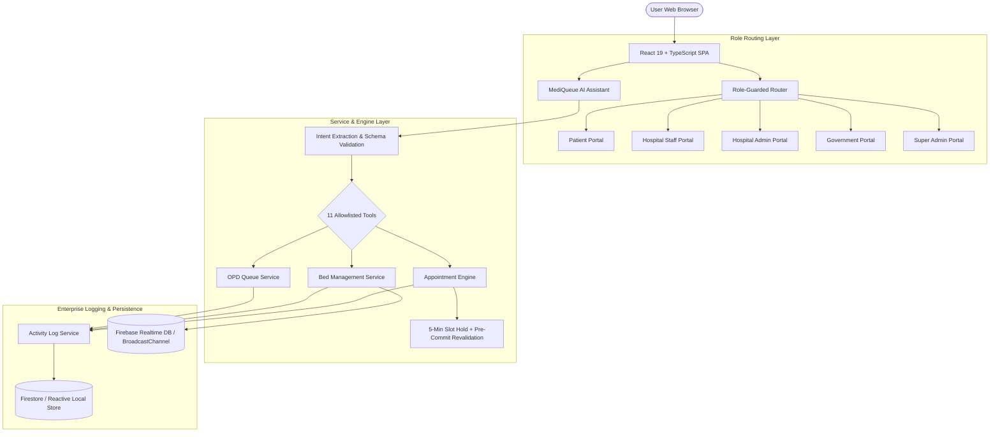

# 🏥 MediQueue AI — Real-Time Hospital Resource Management Platform

> **Academic Prototype Notice**: MediQueue AI is an educational and research software prototype built for academic demonstration. All patient records, physician names, hospitals, diagnostic reports, and operational metrics are **100% synthetic mock data**. It is **not** a certified medical device, is **not** HIPAA/GDPR certified, and must **never** be used for real patient care or live clinical decision-making.

[](https://react.dev/)
[](https://www.typescriptlang.org/)
[](https://vitejs.dev/)
[](https://tailwindcss.com/)
[](https://vitest.dev/)
[](#-security-model--rbac-matrix)
[](#-production-deployment)

---

## 🌟 1. Project Overview

Modern healthcare facilities struggle with uncoordinated outpatient waiting times, delayed inpatient bed turnover, opaque physician schedules, and regional emergency turnaways. **MediQueue AI** is an intelligent, real-time hospital resource coordination and outpatient management platform built to streamline clinical workflows across five key healthcare roles:

1. **Patients**: Discover hospitals, locate doctors, reserve outpatient consultation slots with concurrency safety, track live OPD token numbers, view diagnostic reports, and interact with the **MediQueue AI Assistant**.
2. **Hospital Staff & Clinicians**: Manage ward bed turnover across live states (`available`, `cleaning`, `occupied`, `maintenance`), operate outpatient token callers, and execute inpatient admissions and discharges.
3. **Hospital Administrators**: Monitor real-time census metrics, analyze department-level bed occupancy, manage medical staff schedules, and review operational throughput.
4. **Government & Public Health Officers**: Monitor district-level hospital capacity, detect public health surges (>85% bed occupancy), and compare regional healthcare utilization with strict PHI anonymization.
5. **Super Administrators**: Onboard multi-tenant hospital facilities, configure system-wide access policies, and inspect central enterprise security and activity audit logs.

---

## ⚡ 2. Main Features

- **5 Dedicated Role Portals**: Tailored interfaces and strict authorization boundaries for Patient, Hospital Staff, Hospital Admin, Government Officer, and Super Admin.
- **Hybrid MediQueue AI Assistant**:
  - Natural language intent extraction mapped to an explicit **allowlist of 11 clinical tools**.
  - Structured parameter validation and backend role authorization prior to execution.
  - Consequential actions require explicit patient confirmation dialogs.
  - Fully offline, rule-based fallback when no external LLM credentials are configured.
- **Concurrency-Safe Appointment Booking Engine**:
  - Composite slot identification (`slot_${hospitalId}_${deptId}_${doctorId}_${date}_${time}`).
  - 5-minute pre-booking reservation hold to prevent double-booking.
  - Pre-commit revalidation ensuring exclusive slots never exceed one confirmed booking.
  - Complete appointment lifecycle: booking, status lookup, rescheduling, and cancellation.
- **Real-Time Ward Bed Turnover**:
  - Ward bed state transitions (`available`, `cleaning`, `occupied`, `maintenance`) updated live across all active client views.
- **OPD Queue Desk**:
  - Doctor token caller with active consultation velocity tracking and estimated waiting room duration.
- **District Health Surveillance**:
  - Regional bed occupancy heatmaps and automatic surge alert triggers without exposing identifiable patient records.
- **Enterprise Activity & Security Logging**:
  - Centralized, queryable event log capturing timestamp, actor identity, role, hospital scope, event category, and operational severity.
- **Dual Operating Modes**:
  - **Demonstration Mode**: Zero-credential local simulation with 5 synthetic hospitals, 180 beds, and 55 patients.
  - **Cloud Mode**: Production-grade Firebase Authentication, Firestore database isolation, and Realtime Database live event synchronization.

---

## 🛠️ 3. Technology Stack

- **Frontend Core**: React 19, TypeScript 5, Vite 8
- **Styling**: Tailwind CSS, Lucide React Icons
- **Data Visualization**: Recharts (Executive census, department occupancy, queue wait times)
- **State & Real-Time Sync**: Reactive Local Storage & Web BroadcastChannel (Demo Mode) / Firebase Firestore & Realtime Database (Cloud Mode)
- **Authentication**: Firebase Auth (Cloud Mode) / Persona Simulation Switcher (Demo Mode)
- **Testing Framework**: Vitest, @testing-library/react
- **Deployment**: Vercel (SPA rewrites via `vercel.json`), Firebase Hosting (`firebase.json`)

---

## 🏛️ 4. System Architecture



---

## 📁 5. Repository Structure

```
mediqueue/
├── .env.example             # Environment template (Firebase & LLM credentials)
├── DEMO_SCRIPT.md           # 12-step guided university demonstration script
├── DEPLOYMENT_GUIDE.md      # Turnkey Vercel & Firebase Hosting deployment instructions
├── IMPLEMENTATION_AUDIT.md  # Detailed project audit & remediation report
├── PRESENTATION_GUIDE.md    # Comprehensive faculty presentation guide & technical defenses
├── database.rules.json      # Firebase Realtime Database security rules
├── firestore.rules          # Firebase Cloud Firestore security rules
├── firebase.json            # Firebase Hosting & rule deployment configuration
├── vercel.json              # Vercel SPA route rewrite configuration
├── package.json             # Scripts & dependencies
├── src/
│   ├── components/          # Reusable UI cards, modals, navigation & layouts
│   ├── config/              # Firebase initialization & application constants
│   ├── context/             # React context providers (AuthContext, DemoContext)
│   ├── pages/               # 5 Role-based portal views & dashboards
│   │   ├── admin/           # Hospital Admin views (Analytics, Beds, Staff)
│   │   ├── government/      # Government views (Surveillance, Surge Alerts)
│   │   ├── patient/         # Patient views (Directory, Booking, AI Assistant, Queue)
│   │   ├── staff/           # Clinical Staff views (Ward Beds, OPD Queue, Admissions)
│   │   └── superadmin/      # Super Admin views (Hospital Onboarding, Activity Logs)
│   ├── services/            # Clinical domain services
│   │   ├── ai/              # Hybrid MediQueue AI assistant (11 intents & tool handlers)
│   │   ├── appointments/    # Concurrency-safe appointment booking engine
│   │   ├── logging/         # Enterprise activity & security audit log service
│   │   ├── firebase.ts      # Cloud Firebase connector
│   │   └── mockStorage.ts   # Reactive local storage engine with synthetic seed data
│   └── types/               # TypeScript data models & domain interfaces
└── tests/                   # Automated Vitest test suites (23 tests)
    ├── activity_logs.test.ts
    ├── appointments_workflow.test.ts
    ├── auth_permissions.test.ts
    └── demo_behavior.test.ts
```

---

## 🚀 6. Installation Instructions

### Prerequisites
- **Node.js**: v18.0.0 or later (v20+ recommended)
- **npm**: v9.0.0 or later

```bash
# 1. Clone the repository
git clone https://github.com/MahithKarempudi/mediqueue.git
cd mediqueue

# 2. Install dependencies
npm install

# 3. Launch local development server
npm run dev
```

Open your browser at **`http://localhost:5173`**. The application launches immediately in **Demonstration Mode** with zero cloud credentials required.

---

## ⚙️ 7. Environment Setup

MediQueue runs out-of-the-box locally without an `.env` file. To connect to live cloud services, create a `.env` file in the project root:

```bash
cp .env.example .env
```

Configure your credentials:
```env
# Mode Selector: 'demo' or 'cloud'
VITE_APP_MODE=demo

# Firebase Cloud Configuration (Required for Cloud Mode)
VITE_FIREBASE_API_KEY=your_firebase_api_key
VITE_FIREBASE_AUTH_DOMAIN=your_project.firebaseapp.com
VITE_FIREBASE_PROJECT_ID=your_project_id
VITE_FIREBASE_STORAGE_BUCKET=your_project.appspot.com
VITE_FIREBASE_MESSAGING_SENDER_ID=your_messaging_sender_id
VITE_FIREBASE_APP_ID=your_app_id
VITE_FIREBASE_DATABASE_URL=https://your_project-default-rtdb.firebaseio.com

# Optional Cloud LLM API Keys (Groq, OpenAI, or Gemini)
# If left blank, MediQueue activates its built-in rule-based intent parser
VITE_AI_PROVIDER=rule_based
VITE_GROQ_API_KEY=
VITE_OPENAI_API_KEY=
VITE_GEMINI_API_KEY=
```

---

## 👥 8. Demo Login Instructions & Personas

When running in Demonstration Mode, use the top-bar **Persona Switcher** to test all 5 stakeholder roles instantly without passwords:

| Persona | Role | Simulated Identity | Core Authorized Capabilities |
| :--- | :--- | :--- | :--- |
| **Priya Sharma** | `patient` | `pat_demo_01` | Search doctors, book OPD slots, converse with AI Assistant, track live queue tokens, view own bills and diagnostic records. |
| **Dr. Rajesh Kumar** | `staff` | `hosp_metro_01` | Update ward bed status (`available`, `cleaning`, `occupied`), call OPD tokens, issue clinical prescriptions. |
| **Sunita Rao** | `hospital_admin` | `hosp_metro_01` | Review executive hospital census, inspect department bed utilization, manage clinical staff rosters. |
| **Vikramaditya Sen** | `government_officer` | District Directorate | View district bed occupancy heatmaps and hospital surge alerts. **Strictly blocked from individual patient PHI**. |
| **Dev Anand** | `super_admin` | System Directorate | Onboard new hospital tenants, provision administrator accounts, inspect central enterprise activity audit logs. |

---

## ☁️ 9. Firebase Setup (Cloud Mode)

To run with live Firebase Cloud infrastructure:
1. Create a project at the [Firebase Console](https://console.firebase.google.com/).
2. Enable **Authentication** (Email/Password provider).
3. Enable **Cloud Firestore** and deploy security rules:
   ```bash
   firebase deploy --only firestore:rules
   ```
4. Enable **Realtime Database** and deploy database rules:
   ```bash
   firebase deploy --only database
   ```
5. Set `VITE_APP_MODE=cloud` and paste your Firebase credentials into `.env`.

---

## 🤖 10. AI Provider Setup

The **MediQueue AI Assistant** supports 11 structured clinical intents:
- `searchHospitals`, `searchDepartments`, `searchAppointmentSlots`, `bookAppointment`, `checkAppointmentStatus`, `rescheduleAppointment`, `cancelAppointment`, `checkBedAvailability`, `checkOpdQueueStatus`, `updateBedStatus`, `getHospitalOperationalSummary`.

### Operating Options:
1. **Rule-Based Engine (Default / Zero-Config)**: Operates out-of-the-box locally with zero external API calls or latency.
2. **Groq / Llama 3**: Provide `VITE_GROQ_API_KEY` for serverless open-source LLM inference.
3. **OpenAI GPT-4o / Gemini**: Provide `VITE_OPENAI_API_KEY` or `VITE_GEMINI_API_KEY`.

---

## 💻 11. Local Execution

```bash
# Start Vite development server
npm run dev

# Run linting and code quality checks
npm run lint

# Build production bundle for verification
npm run build
```

---

## 🌐 12. Production Deployment

### Option A: Vercel (Recommended for Showcase)
1. Push your repository to GitHub.
2. Import the project in [Vercel](https://vercel.com).
3. Vercel automatically detects the Vite preset and uses [vercel.json](file:///Users/mahithchowdary/.gemini/antigravity-ide/scratch/mediqueue/vercel.json) for SPA routing.
4. Click **Deploy**.

### Option B: Firebase Hosting
1. Build the production bundle: `npm run build`
2. Deploy to Firebase: `firebase deploy --only hosting`

For comprehensive deployment instructions, consult [DEPLOYMENT_GUIDE.md](file:///Users/mahithchowdary/.gemini/antigravity-ide/scratch/mediqueue/DEPLOYMENT_GUIDE.md).

---

## 🧪 13. Testing Instructions

MediQueue includes automated unit, integration, and security tests powered by **Vitest**:

```bash
npm test
```

### Verified Test Suites (23 / 23 Tests Passing):
- **`activity_logs.test.ts`**: Verifies enterprise activity log ingestion, filtering by category (`APPOINTMENT`, `BED_STATUS`, `AUTH`), actor identity tracking, and severity thresholds.
- **`auth_permissions.test.ts`**: Verifies strict role-based access control (RBAC), facility isolation, and denial of unauthorized cross-tenant operations.
- **`appointments_workflow.test.ts`**: Verifies the complete 4-stage appointment lifecycle: slot searching, 5-minute hold placement, consent validation, atomic confirmation, and rescheduling.
- **`demo_behavior.test.ts`**: Verifies deterministic synthetic seeding of 5 hospitals, 180 beds, and 55 patients.

---

## ⚠️ 14. Current Limitations & Academic Disclaimer

- **Academic Simulation**: MediQueue is strictly an educational software engineering prototype. All clinical data is synthetic.
- **Not a Medical Device**: The platform is not certified for clinical diagnostic use, triage decision-making, or emergency dispatch.
- **Demo Mode Seam**: In Demo Mode, cross-tab synchronization uses browser BroadcastChannels rather than websockets.
- **Regulatory Status**: The platform has not undergone HIPAA, GDPR, or HITECH regulatory compliance audits.

---

## 📄 License

This project is licensed under the MIT License — see the [LICENSE](file:///Users/mahithchowdary/.gemini/antigravity-ide/scratch/mediqueue/LICENSE) file for details.
